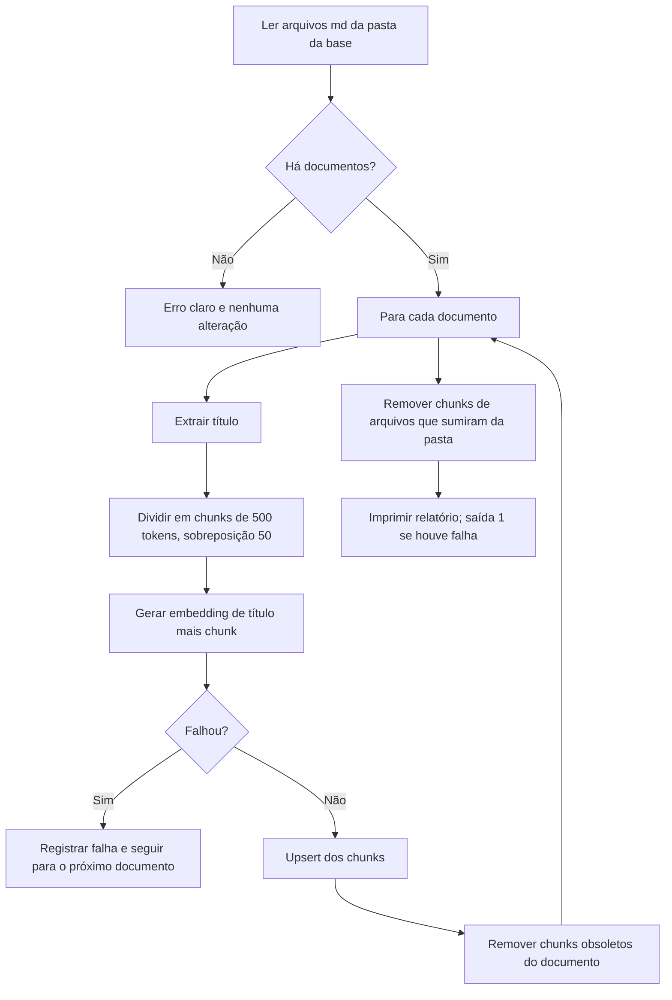
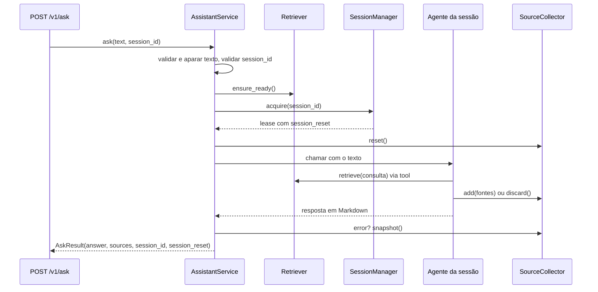

# Modelo de Lógica de Negócio: Backend

## 1. Ingestão (`KnowledgeIngestor.run`)

Texto alternativo: ler os documentos; sem documentos, falhar sem alterar nada; para cada documento, extrair o título, dividir, gerar embeddings, gravar e remover chunks obsoletos; falhas de um documento não impedem os demais; no fim, remover chunks de arquivos apagados e imprimir o relatório.

## 2. Recuperação (`Retriever.retrieve`)

1. Gerar o embedding da pergunta.
2. Consultar o `KnowledgeStore` pelos `top_k` mais próximos (distância de cosseno).
3. Manter só os trechos com distância menor ou igual ao limite.
4. Deduplicar as fontes por arquivo na ordem de relevância.
5. Devolver trechos, fontes e `has_relevant`.

## 3. Turno de conversa (`AssistantService.ask`)

Texto alternativo: a API chama o serviço; o serviço valida a entrada, confirma que a base está indexada, obtém a sessão com trava, zera o coletor e chama o agente; o agente consulta o `Retriever` por uma tool e registra ou descarta fontes; o serviço relança erros registrados no coletor e devolve resposta, fontes, id e `session_reset`.

Regras de decisão do turno:
- Entrada inválida: `VALIDATION_ERROR`, sem Bedrock.
- Base não indexada: `KB_NOT_INDEXED`, sem Bedrock.
- Erro registrado no coletor: relançado como o erro original (`UPSTREAM_ERROR`).
- Exceção do agente que não seja `AppError`: `UPSTREAM_ERROR`.
- Resposta vazia do agente: `UPSTREAM_ERROR`.
- Em qualquer caminho, a trava da sessão é liberada.

## 4. Sessões (`SessionManager.acquire`)

1. Sob a trava do gerenciador: sem `session_id`, criar com UUID v4 (`session_reset = false`); `session_id` conhecido, reaproveitar e marcar como mais recente (`false`); desconhecido, criar com o mesmo id (`true`).
2. Se o total passar de 50, descartar a menos recentemente usada, nunca a que acabou de ser obtida.
3. Fora da trava do gerenciador, a `SessionLease` adquire a trava da sessão ao entrar no bloco e a libera ao sair.

## 5. Propriedades testáveis (PBT-01)

Framework: Hypothesis. Geradores de domínio ficam em `tests/strategies.py` (PBT-07).

| Componente | Propriedade | Categoria | Regra PBT |
|---|---|---|---|
| `split_into_chunks` | Todo chunk tem no máximo `size` tokens | Invariante | PBT-03 |
| `split_into_chunks` | Cada palavra do texto original aparece inteira em algum chunk | Invariante | PBT-03 |
| `split_into_chunks` | Nenhum chunk é vazio; texto em branco gera lista vazia | Invariante | PBT-03 |
| `split_into_chunks` | Texto que cabe em `size` tokens gera um único chunk igual ao texto aparado | Invariante | PBT-03 |
| `extract_title` / formatação `# título` | Formatar um H1 e extrair devolve o título original | Round-trip | PBT-02 |
| `build_chunk_id` | Determinístico e injetivo para pares (arquivo, índice) distintos | Invariante | PBT-03 |
| `title_from_stem` | Nunca devolve vazio e não contém `_` | Invariante | PBT-03 |
| `AskRequest`, `AskResponse`, `SourceRef` | Serializar para JSON e ler de volta devolve o mesmo objeto | Round-trip | PBT-02 |
| `to_error_body` | O corpo gerado valida como `ErrorResponse` e preserva código e mensagem | Round-trip | PBT-02 |
| `dedupe_sources` | Idempotente; sem arquivos repetidos; preserva a ordem da primeira aparição | Idempotência e invariante | PBT-04, PBT-03 |
| `filter_relevant` | Todos os itens mantidos têm distância dentro do limite; é subsequência da entrada; limite maior mantém pelo menos os mesmos itens | Invariante | PBT-03 |
| `validate_ask_input` | O texto devolvido não tem espaços nas pontas; validar de novo o resultado devolve o mesmo valor; `session_id` fora do padrão é sempre rejeitado | Idempotência e invariante | PBT-04, PBT-03 |
| `SourceCollector` | `snapshot` não repete arquivos; depois de `discard` fica vazio | Invariante | PBT-03 |
| `SessionManager` | Número de sessões nunca passa do limite; a sessão obtida por último está sempre presente | Invariante, com modelo simples (PBT-06 orientativo) | PBT-03 |
| `Settings.from_env` | Valores numéricos fora do domínio são rejeitados; valores válidos fazem round-trip pelo ambiente | Invariante | PBT-03 |

Componentes sem propriedades relevantes:
- `BedrockEmbeddingClient`, `KnowledgeStore` (fina camada sobre o ChromaDB), `dependencies.py` e `main.py`: sem PBT, por serem camadas de integração. Cobertos por testes de exemplo e de integração.
- `agent.py`: o prompt e a montagem do agente não têm propriedade geral. As tools são cobertas por exemplos.

Testes de exemplo (PBT-10) cobrem os cenários dos critérios de aceitação: pergunta coberta pela base, fora da base, acompanhamento, texto vazio, `session_reset` e idempotência da ingestão.
