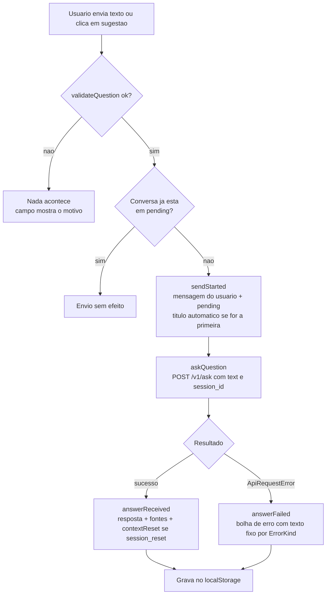

# Modelo de Lógica de Negócio: Frontend

Descreve funções puras, o reducer, os fluxos e as propriedades testáveis (PBT-01). Os identificadores `BR-*`, `INV-*` e `Q*` apontam para `business-rules.md`, `domain-entities.md` e o plano.

**Princípio de pureza:** tudo que depende de relógio, geração de ids ou armazenamento é injetado. O reducer e as funções da seção 1 não geram ids, não leem a hora e não tocam o `localStorage`. Isso permite testá-los com propriedades.

## 1. Funções puras

| Função | Assinatura | Comportamento | Regras |
|---|---|---|---|
| `codePointLength` | `(s: string) => number` | Conta pontos de código Unicode (igual ao `len` do Python no Backend) | BR-ENV-03 |
| `validateQuestion` | `(raw: string) => { ok: true; text: string } \| { ok: false; reason: "empty" \| "too_long"; length: number }` | Apara `raw`. Vazio: `empty`. Mais de 2000 pontos de código: `too_long`. Caso contrário `ok` com o texto aparado | BR-ENV-01 a BR-ENV-03 |
| `deriveTitle` | `(text: string) => string` | Normaliza espaços e quebras de linha para um espaço, apara, corta em 40 pontos de código e acrescenta "…" se cortou. Resultado vazio vira `DEFAULT_TITLE` | BR-CNV-02 |
| `normalizeRename` | `(raw: string) => string \| null` | Apara. Vazio devolve `null` (cancela). Mais de 60 pontos de código é cortado em 60 | BR-CNV-06 |
| `dedupeSources` | `(sources: SourceRef[]) => SourceRef[]` | Mantém a primeira ocorrência de cada `file`, preservando a ordem | BR-ENV-09, BR-UI-02 |
| `sortConversations` | `(list: Conversation[]) => Conversation[]` | Ordena por `updatedAt` decrescente, estável. Não altera a entrada | BR-CNV-09 |
| `isEmptyConversation` | `(c: Conversation) => boolean` | `messages.length === 0` | BR-CNV-03 |
| `errorText` | `(kind: ErrorKind) => string` | Texto fixo em português por tipo de erro | BR-ERR-01 |
| `serializeState` | `(state: PersistedState) => string` | JSON do formato persistido | BR-PER-01 |
| `parseState` | `(raw: string \| null) => PersistedState \| null` | Valida e filtra conforme BR-PER-03 a BR-PER-05. Nunca lança exceção. `null` significa "iniciar vazio" | BR-PER-03 a BR-PER-05 |
| `createInitialState` | `(persisted: PersistedState \| null, fresh: () => Conversation, now: string) => ConversationsState` | Garante INV-03 e INV-04, aplica BR-ERR-06 (bolha `NO_RESPONSE`) e zera `pending` e `storageWarning`. `fresh` e `now` vêm de fora | BR-CNV-10, BR-ERR-06, BR-PER-05 |

## 2. Reducer de conversas

`conversationsReducer(state, action) => state`. Ações que precisam de id novo, `sessionId` novo ou hora recebem esses valores no próprio payload.

| Ação | Payload | Efeito |
|---|---|---|
| `create` | `fresh: Conversation` | Se existe conversa vazia: seleciona a vazia mais recentemente atualizada (BR-CNV-03). Senão: adiciona `fresh` e a seleciona |
| `select` | `id` | Se o id existe: torna ativa. Senão: não muda (BR-CNV-11) |
| `rename` | `id, title, now` | `normalizeRename`: `null` ou id inexistente não muda nada. Senão atualiza `title`, `titleIsCustom = true`, `updatedAt = now` (BR-CNV-06, BR-CNV-07) |
| `delete` | `id, replacement: Conversation` | Remove a conversa e sua entrada em `pending`. Se era a ativa: seleciona a mais recente das restantes. Se não sobrou nenhuma: adiciona `replacement` e a seleciona (BR-CNV-05) |
| `sendStarted` | `conversationId, message: Message (user), now` | Ignora se a conversa não existe ou já está em `pending`. Senão: adiciona a mensagem, marca `pending`, atualiza `updatedAt`. Se a conversa estava vazia e `titleIsCustom = false`: `title = deriveTitle(message.content)` (BR-CNV-02, BR-ENV-06) |
| `retryStarted` | `conversationId, now` | Ignora se a conversa não existe, já está em `pending` ou se a última mensagem não é uma bolha de erro precedida por mensagem do usuário. Senão: remove a bolha de erro, marca `pending`, atualiza `updatedAt` (BR-ERR-03, BR-ERR-04) |
| `answerReceived` | `conversationId, message: Message (assistant), now` | Conversa inexistente: ignora (BR-ENV-11). Senão: normaliza `sources` com `dedupeSources`, adiciona a mensagem, remove de `pending`, atualiza `updatedAt` |
| `answerFailed` | `conversationId, message: Message (erro), now` | Conversa inexistente: ignora. Senão: adiciona a bolha de erro, remove de `pending`, atualiza `updatedAt` |
| `setStorageWarning` | `value: boolean` | Atualiza `storageWarning` (BR-PER-06) |

Todas as ações preservam INV-01 a INV-09. `sessionId` e `id` das conversas existentes nunca mudam.

## 3. Fluxo de inicialização (US-15)

1. `loadConversations` lê `STORAGE_KEY` do `localStorage`. Qualquer exceção do armazenamento (bloqueado, indisponível) é tratada como "sem dados".
2. `parseState` valida o texto. Falha total: `null`.
3. `createInitialState` monta o estado: descarta conversas inválidas (BR-PER-04), escolhe a conversa ativa (BR-PER-05), adiciona a bolha `NO_RESPONSE` nas conversas que terminam em pergunta sem resposta (BR-ERR-06) e cria uma conversa vazia se não restou nenhuma (BR-CNV-10).
4. O provedor entrega o estado aos componentes. Se a conversa inicial foi criada ou a bolha `NO_RESPONSE` foi adicionada, o estado é gravado (passo da seção 6).

## 4. Fluxo de envio de pergunta (US-11, US-10)

Texto alternativo: o texto é validado; se for inválido, nada acontece e o campo explica o motivo. Se a conversa já espera resposta, o envio não tem efeito. Caso contrário o reducer adiciona a mensagem do usuário e marca a conversa como carregando, o `ApiClient` chama `POST /v1/ask`, e o resultado vira uma resposta com fontes (e aviso de contexto reiniciado quando `session_reset` for verdadeiro) ou uma bolha de erro. Depois o estado é gravado no `localStorage`.

Detalhes do hook `useChat`:
- O `id` e o `sessionId` da conversa são lidos no momento do envio e usados até o fim da chamada. A resposta é entregue a essa conversa mesmo que outra tenha sido selecionada (BR-ENV-11).
- `id` e `createdAt` das mensagens são gerados pelo hook (`generateId` e relógio injetáveis).
- `sendMessage(text)` trata apenas a conversa ativa no momento da chamada. `retryLast()` aplica BR-ERR-03 e BR-ERR-04 sobre a conversa ativa: despacha `retryStarted`, lê o texto da mensagem do usuário anterior e repete a chamada.
- `isLoading` é verdadeiro quando a conversa ativa está em `pending`.

## 5. Comportamento do ApiClient (FC-01)

`askQuestion(text, sessionId, signal?) => Promise<AskResponse>`

1. Envia `POST {API_BASE_URL}/v1/ask` com `Content-Type: application/json` e corpo `{ "text", "session_id" }`.
2. Cria um cancelamento por tempo (90 s). Se o tempo estourar, cancela a requisição e lança `ApiRequestError("TIMEOUT")`. Se o `signal` externo cancelar, a chamada termina sem classificar como erro de tempo.
3. `fetch` rejeitado sem ser cancelamento: `ApiRequestError("NETWORK")`.
4. Status fora de 2xx: tenta ler o corpo como JSON. Se for `{ "error": { "code": string } }` com `code` em `VALIDATION_ERROR`, `KB_NOT_INDEXED`, `UPSTREAM_ERROR` ou `INTERNAL_ERROR`, lança com esse tipo; com outro `code`, lança `INTERNAL_ERROR`. Corpo ilegível ou fora do formato: `UNEXPECTED_RESPONSE`.
5. Status 2xx: valida `answer` (string não vazia), `sources` (lista de objetos com `file` e `title` strings), `session_id` (string) e `session_reset` (boolean). Qualquer falha: `UNEXPECTED_RESPONSE`.

O `message` do corpo de erro é lido apenas para validar o formato e descartado.

## 6. Fluxo de persistência (FC-02 e FC-03)

1. O provedor observa `conversations` e `activeConversationId`. A cada mudança, chama `saveConversations(serializeState(...))`.
2. `saveConversations` captura exceções do `localStorage` (cota, bloqueio) e devolve sucesso ou falha.
3. Em falha, o provedor despacha `setStorageWarning(true)`. Em sucesso após uma falha, despacha `setStorageWarning(false)`.
4. Mudanças só em `pending` ou `storageWarning` não disparam gravação (BR-PER-02).

## 7. Propriedades testáveis (PBT-01)

Framework previsto: `fast-check` com Vitest (a decisão formal fica no NFR Requirements, PBT-09). Geradores de domínio (PBT-07) ficam em um módulo único de geradores: `SourceRef`, `Message` (usuário, resposta, erro), `Conversation`, estados válidos e sequências de ações válidas. Em falha, a seed e o caminho de contrapartida serão registrados (PBT-08).

| Alvo | Propriedade | Categoria | Regra PBT |
|---|---|---|---|
| `conversationsReducer` | Para qualquer estado válido e qualquer sequência de ações geradas, o estado final satisfaz INV-01 a INV-08 | Invariante, com sequência de ações | PBT-03, PBT-06 (orientativo) |
| `conversationsReducer` | `sessionId` e `id` de conversas existentes nunca mudam | Invariante | PBT-03 |
| `conversationsReducer` | A partir de um estado com no máximo uma conversa vazia, nenhuma sequência produz duas vazias (INV-09) | Invariante | PBT-03 |
| `conversationsReducer` (`delete`) | Excluir qualquer conversa deixa o app com pelo menos uma conversa e uma ativa válida | Invariante | PBT-03 |
| `conversationsReducer` (`answerReceived`, `answerFailed`) | Para conversa inexistente o estado não muda | Invariante | PBT-03 |
| `conversationsReducer` (`sendStarted`) | Enviar duas vezes seguidas na mesma conversa sem resposta no meio adiciona só uma mensagem | Idempotência | PBT-04 |
| `serializeState` e `parseState` | Para qualquer `PersistedState` válido, `parseState(serializeState(s))` devolve `s` | Round-trip | PBT-02 |
| `parseState` | Para qualquer string arbitrária (inclusive JSON bem formado de formato errado), nunca lança exceção e o resultado é `null` ou um estado que satisfaz INV-01, INV-02 e INV-07 | Invariante | PBT-03 |
| `createInitialState` | Para qualquer entrada (`null` ou estado persistido gerado), o resultado satisfaz INV-01 a INV-08 | Invariante | PBT-03 |
| `deriveTitle` | Nunca vazio, sem espaços nas pontas, no máximo 41 pontos de código, e igual a `DEFAULT_TITLE` ou prefixo normalizado do texto | Invariante | PBT-03 |
| `deriveTitle` | `deriveTitle(deriveTitle(x))` tem o mesmo conteúdo de `deriveTitle(x)` quando o resultado não termina em "…" | Idempotência | PBT-04 |
| `normalizeRename` | Resultado nunca é vazio, nem tem espaços nas pontas, nem passa de 60 pontos de código; entrada só com espaços devolve `null` | Invariante | PBT-03 |
| `validateQuestion` | `ok` se e somente se o texto aparado tem entre 1 e 2000 pontos de código; o texto devolvido é igual ao aparado | Invariante | PBT-03 |
| `dedupeSources` | Idempotente; sem `file` repetido; é subsequência da entrada; preserva a ordem da primeira ocorrência | Idempotência e invariante | PBT-04, PBT-03 |
| `sortConversations` | O resultado é uma permutação da entrada, com `updatedAt` não crescente, e a entrada não é alterada | Invariante | PBT-03 |
| `errorText` | Devolve um texto não vazio e em português para todo `ErrorKind` | Invariante (enumeração) | PBT-03 |

Componentes sem propriedades relevantes, cobertos por testes de exemplo:
- `ApiClient`: camada de integração com `fetch` simulado. Exemplos para sucesso, cada `ErrorKind`, tempo esgotado e cancelamento.
- Componentes de interface e `useChat`: comportamento de tela e de fluxo, testado com React Testing Library.
- `MarkdownContent`: segurança de links e imagens verificada por exemplos (links `javascript:`, imagens, HTML bruto).

## 8. Testes de exemplo previstos (PBT-10)

Cobrem os critérios de aceitação em Dado/Quando/Então:

| Cenário | Histórias |
|---|---|
| Enviar com Enter, quebrar linha com Shift+Enter, indicador de carregamento e bloqueio na mesma conversa | US-11 |
| Resposta com Markdown (lista, negrito, tabela) | US-11 |
| Cada tipo de erro mostra o texto fixo e o botão "Tentar novamente" reenvia sem duplicar a mensagem | US-11 |
| Fontes com título e arquivo; sem fontes não mostra lista; várias fontes sem repetição | US-12 |
| Sugestões na conversa vazia, clique envia, somem depois da primeira mensagem | US-13 |
| Nova conversa, trocar, renomear (válido, vazio, Esc), excluir com confirmação e cancelamento, exclusão da ativa | US-14 |
| Recarregar mantém conversas, mensagens, fontes e `sessionId`; armazenamento corrompido inicia vazio; pergunta pendente vira `NO_RESPONSE` | US-15 |
| `session_reset: true` mostra o aviso uma vez, mantém as mensagens, permanece após recarregar | US-10 |
| Resposta que chega depois de trocar ou excluir a conversa | US-14 |
| Falha ao gravar mostra o aviso e some após gravação bem-sucedida | US-15 |
| Campo: contador a partir de 1800, bloqueio acima de 2000, texto só com espaços | US-11 |
| Navegação por teclado, rótulos e foco no diálogo de exclusão | US-11 |

## 9. Compliance de extensões

| Extensão | Situação |
|---|---|
| Security Baseline | N/A (desativada). O checklist básico do NFR-03 está refletido em BR-UI-05 a BR-UI-07 e BR-ERR-07 |
| Resiliency Baseline | N/A (desativada) |
| Property-Based Testing (parcial) | PBT-01 atendido na seção 7. PBT-02, 03, 07 e 08 são aplicados na geração de código; PBT-09 (seleção de `fast-check`) entra no NFR Requirements |
