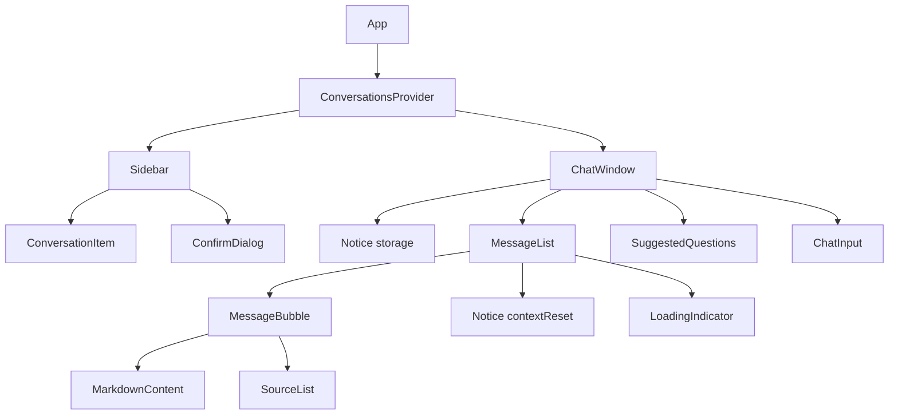

# Componentes do Frontend

Detalha FC-01 a FC-10 do Application Design, com uma adição (FC-11 `ConfirmDialog`) exigida pela confirmação de exclusão (Q3). Regras referenciadas ficam em `business-rules.md`; tipos em `domain-entities.md`; funções puras e reducer em `business-logic-model.md`.

**Organização de arquivos (sem pasta nova):** funções puras de domínio em `src/state/` (`conversationRules.ts`, `questionValidation.ts`) e o formato persistido (`serializeState`, `parseState`) em `src/storage/`, textos de erro em `src/api/errorMessages.ts`, constantes em `src/constants.ts`, tipos em `src/types.ts`. Os testes ficam ao lado dos arquivos.

## Hierarquia

Texto alternativo: `App` compõe o `ConversationsProvider`, que contém a barra lateral (`Sidebar`, com itens de conversa e o diálogo de confirmação) e a janela de chat (`ChatWindow`, com o aviso de armazenamento, a lista de mensagens, as sugestões e o campo de entrada). A lista contém bolhas de mensagem (com Markdown e fontes), o aviso de contexto reiniciado e o indicador de carregamento.

## Estado e hooks

### FC-03 ConversationsProvider e useConversations
- **Estado:** `ConversationsState` (reducer da seção 2 do modelo de lógica).
- **Inicialização:** `loadConversations` e `createInitialState` (sem efeitos assíncronos; o estado já nasce pronto).
- **Efeito de gravação:** salva quando `conversations` ou `activeConversationId` mudam; despacha `setStorageWarning` conforme o resultado (BR-PER-01, BR-PER-02, BR-PER-06).
- **Valor do contexto:** `{ state, dispatch, activeConversation, sortedConversations, isPending(conversationId) }`.
- **Injeção para testes:** `generateId`, `now` e o armazenamento podem ser substituídos nos testes.

### FC-04 useChat
- **Retorno:** `{ sendMessage(text: string): Promise<void>; retryLast(): Promise<void>; isLoading: boolean; canRetry: boolean }`.
- **Uso da API:** chama `askQuestion` (FC-01), único endpoint `POST /v1/ask`.
- **Regras:** BR-ENV-01 a BR-ENV-12, BR-ERR-01 a BR-ERR-04.
- `canRetry` é verdadeiro quando a última mensagem da conversa ativa é uma bolha de erro precedida por mensagem do usuário e a conversa não está carregando.

### FC-01 ApiClient / FC-02 ConversationStorage
Comportamento nas seções 5 e 6 do modelo de lógica. Nenhum componente de interface chama `fetch` ou `localStorage` diretamente.

## Componentes de interface

### FC-05 App
- Compõe `ConversationsProvider`, `Sidebar` e `ChatWindow` em um layout de duas colunas.
- Sem props. Sem estado próprio.

### FC-06 Sidebar
- **Props:** nenhuma (usa `useConversations`).
- **Conteúdo:** botão "Nova conversa" e lista (`ul`) de `ConversationItem` ordenada por `sortedConversations`.
- **Estado local:** id da conversa pendente de exclusão (abre o `ConfirmDialog`).
- **Interações:**
  - "Nova conversa": despacha `create` com uma conversa nova (BR-CNV-01, BR-CNV-03) e leva o foco ao campo de entrada.
  - Clicar em um item: `select`.
  - Confirmar exclusão: `delete` com uma conversa de reposição (BR-CNV-05).
- **Histórias:** US-14, US-15.

### ConversationItem (subcomponente de FC-06)
- **Props:** `conversation`, `isActive`, `onSelect`, `onRename(title)`, `onRequestDelete`.
- **Estado local:** modo de edição e texto em edição.
- **Interações:** botão do título seleciona (`aria-current="true"` se ativo); botão "Renomear conversa {título}" abre o campo na linha; botão "Excluir conversa {título}" pede exclusão.
- **Validação de renomear:** BR-CNV-06 (limite de 60, vazio cancela, Enter confirma, Esc cancela, blur confirma se válido).

### FC-11 ConfirmDialog
- **Props:** `title`, `message`, `confirmLabel`, `cancelLabel`, `onConfirm`, `onCancel`.
- **Comportamento:** BR-CNV-04 e BR-A11Y-05 (`role="alertdialog"`, foco inicial no botão "Cancelar", foco preso, Esc cancela, devolve o foco).
- **Textos na exclusão:** título "Excluir esta conversa?", mensagem "As mensagens desta conversa serão apagadas deste navegador.", botões "Excluir" e "Cancelar".

### FC-07 ChatWindow
- **Props:** nenhuma (usa `useConversations` e `useChat`).
- **Conteúdo:** `Notice` de armazenamento (se `storageWarning`), `MessageList`, `SuggestedQuestions` (se a conversa está vazia), `ChatInput`.
- **Histórias:** US-10, US-11, US-12, US-13.

### MessageList
- **Props:** `messages`, `isLoading`, `canRetry`, `onRetry`.
- **Comportamento:** região `role="log"` com `aria-live="polite"`; rola até o fim (BR-ENV-14); mostra o `Notice` de contexto reiniciado antes da mensagem que tem `contextReset` (BR-CTX-01); mostra `LoadingIndicator` quando `isLoading`; o botão "Tentar novamente" aparece só na última bolha de erro quando `canRetry` (BR-ERR-03).

### MessageBubble
- **Props:** `message`, `showRetry`, `onRetry`.
- **Variantes:** usuário (texto simples, alinhada à direita); assistente (Markdown + fontes); erro (texto simples com estilo de erro; a região `log` da lista já anuncia, então não há `role="alert"` próprio; botão "Tentar novamente" se `showRetry`).

### SourceList
- **Props:** `sources: SourceRef[]`.
- **Comportamento:** não renderiza nada se vazia (BR-UI-03). Para cada fonte: título em destaque e arquivo em texto menor ao lado; só o arquivo se o título é vazio (BR-UI-02). Lista semântica (`ul`) com rótulo "Fontes".

### Notice
- **Props:** `kind: "contextReset" | "storage"` e `children` (texto).
- **Comportamento:** aviso discreto com `role="status"`. Textos fixos: ver BR-CTX-01 e BR-PER-06.

### LoadingIndicator
- **Props:** nenhuma.
- **Comportamento:** animação simples com texto acessível "Aguardando resposta" (BR-A11Y-04).

### FC-08 ChatInput
- **Props:** `onSend(text: string)`, `disabled: boolean` (conversa ativa carregando).
- **Estado local:** rascunho do texto (mantido ao trocar de conversa, BR-ENV-13).
- **Validação:** `validateQuestion` a cada alteração (BR-ENV-01 a BR-ENV-04). Contador "n/2000" a partir de 1800. Acima de 2000 mostra o texto de apoio e bloqueia o envio. Botão "Enviar pergunta" desabilitado se o texto é inválido ou `disabled`.
- **Teclado:** Enter envia, Shift+Enter quebra linha, composição por IME não envia (BR-ENV-05). Rótulo do campo: "Digite sua pergunta".
- **Comportamento após enviar:** limpa o rascunho e mantém o foco no campo. O campo continua editável enquanto carrega; só o envio fica bloqueado (BR-ENV-06).
- **Histórias:** US-11.

### FC-09 SuggestedQuestions
- **Props:** `questions: string[]`, `onSelect(question: string)`, `disabled?: boolean`.
- **Comportamento:** mostra as 4 sugestões (grade 2x2) como botões; clicar chama `onSelect`, que usa `sendMessage` (BR-CNV-12, BR-CNV-13). Só é renderizado em conversas vazias.
- **Histórias:** US-13.

### FC-10 MarkdownContent
- **Props:** `content: string`.
- **Comportamento:** renderiza Markdown com tabelas, listas, negrito e blocos de código; ignora HTML bruto; links `http` e `https` abrem em nova aba com `rel="noopener noreferrer"`; outros protocolos viram texto; imagens não carregam e mostram o texto alternativo (BR-UI-04 a BR-UI-06).
- **Histórias:** US-11.

## Fluxos de interação

| Fluxo | Passos |
|---|---|
| Primeira abertura | O app carrega o armazenamento, cria uma conversa vazia, seleciona e mostra as sugestões |
| Enviar pergunta | Digitar, Enter. A mensagem aparece, o indicador de carregamento surge, a resposta chega com fontes. O título da conversa vira o início da pergunta (se for a primeira) |
| Enviar sugestão | Clicar no botão da sugestão. Segue o fluxo de enviar pergunta |
| Erro | A bolha de erro aparece; "Tentar novamente" repete a pergunta; digitar uma nova pergunta também funciona |
| Contexto reiniciado | Após reinício do Backend, a primeira resposta vem com o aviso acima dela |
| Trocar de conversa | Clicar na barra lateral. Outra conversa pode estar carregando; a resposta dela chega ao lugar certo |
| Renomear | Clicar no lápis, digitar, Enter. Título novo persiste |
| Excluir | Clicar na lixeira, confirmar no diálogo. Outra conversa é selecionada ou uma vazia é criada |
| Recarregar | Conversas, mensagens, fontes e avisos reaparecem. Pergunta sem resposta vira bolha "A resposta não foi recebida" |

## Uso de endpoints do Backend

| Componente | Endpoint | Uso |
|---|---|---|
| `useChat` via `ApiClient` | `POST /v1/ask` | Enviar `{ text, session_id }` e receber `{ answer, sources, session_id, session_reset }` |

O front não chama `GET /health`.

## Validações de formulário

| Campo | Regra | Resposta da interface |
|---|---|---|
| Pergunta | 1 a 2000 caracteres depois de aparar | Botão e Enter sem efeito se vazio; contador a partir de 1800; texto de apoio e bloqueio acima de 2000 |
| Novo título | 1 a 60 caracteres depois de aparar | Vazio cancela e mantém o anterior; campo limitado a 60 |

## Rastreabilidade de histórias

| História | Componentes |
|---|---|
| US-10 (aviso) | `MessageList`, `Notice`, `useChat`, `ConversationsProvider` |
| US-11 | `App`, `ChatWindow`, `MessageList`, `MessageBubble`, `MarkdownContent`, `ChatInput`, `LoadingIndicator`, `ApiClient` |
| US-12 | `SourceList` |
| US-13 | `SuggestedQuestions` |
| US-14 | `Sidebar`, `ConversationItem`, `ConfirmDialog`, `ConversationsProvider` |
| US-15 | `ConversationStorage`, `ConversationsProvider`, `createInitialState` |
| US-16, US-17 | README raiz (Code Generation); sem componente de interface |
