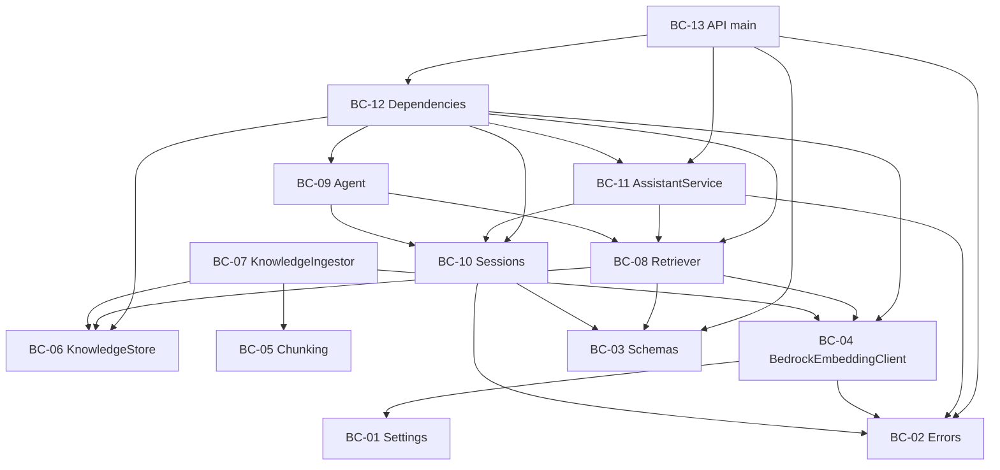
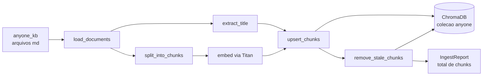
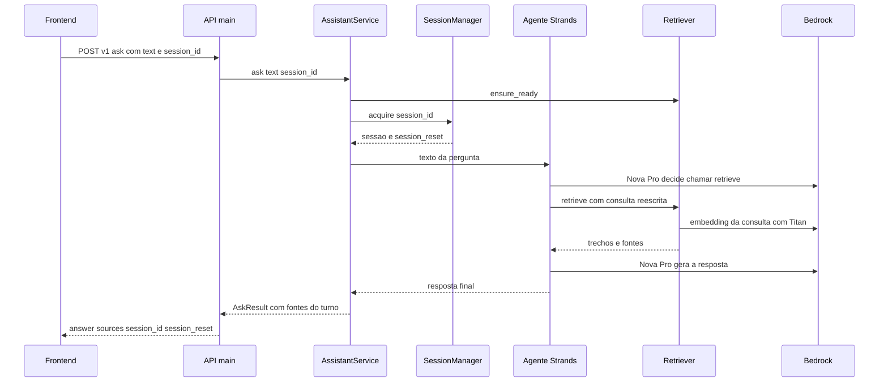
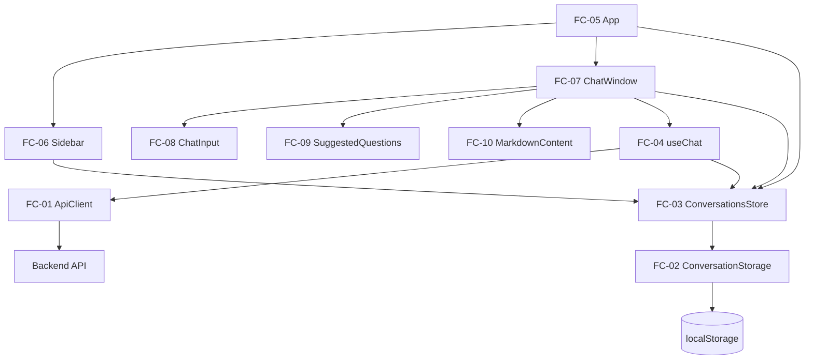

# Dependências e Comunicação

## Backend: matriz de dependências

Cada linha depende das colunas marcadas com X. Não há ciclos: `agent.py` depende de `sessions.py` (para o tipo `SourceCollector`), mas o `SessionManager` recebe a fábrica de agentes por parâmetro, sem importar `agent.py`.

Legenda: 01 Settings, 02 Errors, 03 Schemas, 04 BedrockEmbeddingClient, 05 Chunking, 06 KnowledgeStore, 07 KnowledgeIngestor, 08 Retriever, 09 Agent, 10 Sessions, 11 AssistantService, 12 Dependencies, 13 API.

| Componente | 01 | 02 | 03 | 04 | 05 | 06 | 07 | 08 | 09 | 10 | 11 | 12 | 13 |
|---|---|---|---|---|---|---|---|---|---|---|---|---|---|
| 01 Settings |  |  |  |  |  |  |  |  |  |  |  |  |  |
| 02 Errors |  |  |  |  |  |  |  |  |  |  |  |  |  |
| 03 Schemas |  |  |  |  |  |  |  |  |  |  |  |  |  |
| 04 BedrockEmbeddingClient | X | X |  |  |  |  |  |  |  |  |  |  |  |
| 05 Chunking |  |  |  |  |  |  |  |  |  |  |  |  |  |
| 06 KnowledgeStore |  |  |  |  |  |  |  |  |  |  |  |  |  |
| 07 KnowledgeIngestor | X | X |  | X | X | X |  |  |  |  |  |  |  |
| 08 Retriever | X | X | X | X |  | X |  |  |  |  |  |  |  |
| 09 Agent | X |  |  |  |  |  |  | X |  | X |  |  |  |
| 10 Sessions |  | X | X |  |  |  |  |  |  |  |  |  |  |
| 11 AssistantService | X | X | X |  |  |  |  | X |  | X |  |  |  |
| 12 Dependencies | X |  |  | X |  | X |  | X | X | X | X |  |  |
| 13 API | X | X | X |  |  |  |  |  |  |  | X | X |  |

Dependências externas principais: `boto3` (04), `tiktoken` (05), `chromadb` (06), `strands-agents` (09), `fastapi` e `pydantic` (03, 13), `python-dotenv` (01).

### Diagrama de dependências do backend



### Texto alternativo (backend)

```
API (main) -> Dependencies, AssistantService, Schemas, Errors
Dependencies -> AssistantService, Sessions, Agent, Retriever, KnowledgeStore, BedrockEmbeddingClient
AssistantService -> Sessions, Retriever (ensure_ready), Errors
Agent -> Retriever, Sessions (SourceCollector)
Retriever -> BedrockEmbeddingClient, KnowledgeStore, Schemas
KnowledgeIngestor -> BedrockEmbeddingClient, KnowledgeStore, Chunking
BedrockEmbeddingClient -> Settings, Errors
Sessions -> Schemas, Errors
```

## Padrões de comunicação do backend

| Origem | Destino | Padrão |
|---|---|---|
| Front-end | API | HTTP/JSON síncrono; resposta completa sem streaming; CORS só para `http://localhost:5173` |
| API | AssistantService | Chamada de função, via `Depends` |
| AssistantService | Agente | Chamada síncrona ao agente da sessão, com a trava da sessão adquirida |
| Agente | Retriever | Chamada de tool pelo Strands (`retrieve`) e, quando a base não responde, `not_in_knowledge_base` |
| Retriever | BedrockEmbeddingClient e KnowledgeStore | Chamadas de função |
| BedrockEmbeddingClient | Amazon Bedrock | HTTPS via boto3, com `AWS_BEARER_TOKEN_BEDROCK` |
| Agente | Amazon Bedrock (Nova Pro) | HTTPS pelo `BedrockModel` do Strands |
| KnowledgeStore | ChromaDB | Arquivos locais em `backend/chroma_store/` |
| KnowledgeIngestor | Disco | Leitura de `anyone_kb/*.md` |

## Fluxo de dados: ingestão (offline)



Texto alternativo: os arquivos de `anyone_kb/` são lidos, o título H1 é extraído, o texto é dividido em chunks, cada chunk recebe um embedding do Titan, os chunks são gravados com `upsert` no ChromaDB, os chunks obsoletos do documento são removidos e o relatório com o total de chunks é impresso.

## Fluxo de dados: uma pergunta



Texto alternativo: o front envia a pergunta e o `session_id`; a API chama o `AssistantService`, que confirma a base indexada, obtém a sessão e chama o agente; o agente usa a tool `retrieve`, o `Retriever` gera o embedding da consulta e busca no ChromaDB, o Nova Pro gera a resposta com os trechos, e o serviço devolve a resposta com as fontes do turno e `session_reset`.

## Frontend: dependências

| Componente | Depende de |
|---|---|
| FC-01 ApiClient | `types.ts`, variável `VITE_API_BASE_URL` (padrão `http://localhost:8000`) |
| FC-02 ConversationStorage | `types.ts` |
| FC-03 ConversationsStore | FC-02, `types.ts` |
| FC-04 useChat | FC-01, FC-03 |
| FC-05 App | FC-03 (provedor), FC-06, FC-07 |
| FC-06 Sidebar | FC-03 (via `useConversations`) |
| FC-07 ChatWindow | FC-04, FC-03, FC-08, FC-09, SourceList, Notice, FC-10 |
| FC-08 ChatInput | nenhuma (recebe `onSend` e `disabled`) |
| FC-09 SuggestedQuestions | nenhuma (recebe `questions` e `onSelect`) |
| FC-10 MarkdownContent | `react-markdown`, `remark-gfm` |



Texto alternativo: o `App` compõe a barra lateral e a janela de chat sobre o `ConversationsStore`; a janela usa o campo de entrada, as sugestões e o renderizador de Markdown; o hook `useChat` chama o `ApiClient` (que fala com a API do backend) e atualiza o `ConversationsStore`, que persiste no `localStorage` por meio do `ConversationStorage`.

## Contrato entre as unidades

O Frontend depende apenas do contrato HTTP do Backend:

- `GET /health` retorna `{ "status": "ok" }`.
- `POST /v1/ask` recebe `{ "text", "session_id"? }` e devolve `{ "answer", "sources": [{ "file", "title" }], "session_id", "session_reset" }`.
- Erros: `{ "error": { "code", "message" } }` com os códigos `VALIDATION_ERROR`, `KB_NOT_INDEXED` e `UPSTREAM_ERROR`.
