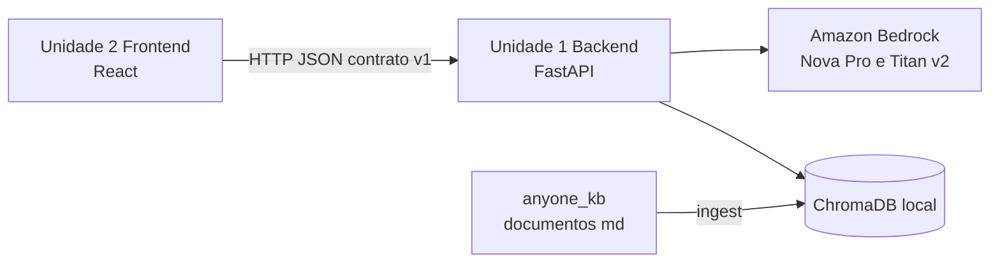

# Dependências entre Unidades

## Matriz de dependências

Cada linha depende das colunas marcadas com X.

| Unidade | Backend | Frontend |
|---|---|---|
| Backend |  |  |
| Frontend | X (contrato HTTP) |  |

- O **Backend não depende do Frontend**: ele pode ser construído, testado e executado sozinho (por exemplo, com `curl`).
- O **Frontend depende do contrato HTTP do Backend**, e não do código dele. Nenhum código é compartilhado entre as unidades.
- Ambas dependem de fatores externos: Amazon Bedrock (só o Backend), `anyone_kb/` e o `.env` na raiz (só o Backend).



Texto alternativo: o Frontend chama o Backend por HTTP/JSON (contrato `v1`); o Backend usa o Amazon Bedrock e o ChromaDB local; a ingestão lê `anyone_kb/` e grava no ChromaDB.

## Sequência de construção e justificativa

1. **Backend primeiro:** o contrato fica implementado e testado antes da interface.
2. **Frontend depois:** é construído contra o contrato abaixo, com `fetch` simulado nos testes. A integração real é verificada no Build and Test.

## Contrato HTTP v1

**URL base local:** `http://localhost:8000`. O Frontend permite sobrescrever por `VITE_API_BASE_URL`. **CORS:** liberado apenas para `http://localhost:5173`.

### `GET /health`
- Resposta: `{ "status": "ok" }`.

### `POST /v1/ask`
- Requisição: `{ "text": string, "session_id"?: string }`
  - `text`: obrigatório, não vazio, sem ser só espaços, com tamanho máximo definido no NFR Requirements.
  - `session_id`: opcional. Sem ele, o Backend cria uma sessão.
- Resposta de sucesso:
  ```json
  {
    "answer": "string em Markdown",
    "sources": [ { "file": "string", "title": "string" } ],
    "session_id": "string",
    "session_reset": false
  }
  ```
  - `sources` é uma lista vazia quando a resposta não veio da base interna.
  - `session_reset` é `true` quando o `session_id` enviado era desconhecido e foi criada uma sessão nova com o mesmo id.
- Resposta de erro (campos em `snake_case`):
  ```json
  { "error": { "code": "VALIDATION_ERROR", "message": "string" } }
  ```
  - Códigos: `VALIDATION_ERROR` (texto inválido), `KB_NOT_INDEXED` (base não indexada), `UPSTREAM_ERROR` (falha ao chamar o Bedrock).
  - O mapeamento de códigos HTTP (4xx e 5xx) por tipo de erro será definido no Functional Design do Backend e refletido nos testes do Frontend.
- As mensagens de erro não expõem segredos nem detalhes internos.

## Pontos de verificação da integração (Build and Test)

| Ponto | Verificação |
|---|---|
| Contrato | Os tipos do Frontend (`AskResponse`, `ApiError`, `SourceRef`) correspondem à resposta real do Backend |
| CORS | O Frontend em `localhost:5173` consegue chamar o Backend em `localhost:8000` |
| Sessões | Perguntas de acompanhamento mantêm o contexto; reiniciar o Backend gera `session_reset: true` e o aviso na interface |
| Fontes | O título H1 e o arquivo exibidos correspondem às fontes devolvidas |
| Entrega | US-16 e US-17: seguir o README raiz do zero e subir ingestão, Backend e Frontend |
