# Execution Plan

Projeto: Assistente de Conhecimento Interno da Anyone Agro Business (greenfield, execução local).
Fontes: `requirements.md`, `stories.md`, `personas.md`, `tech-env.md`.

## Detailed Analysis Summary

### Transformation Scope (Brownfield Only)
Não se aplica. O projeto é greenfield e o workspace não tem código-fonte.

### Change Impact Assessment
- **User-facing changes**: Sim. Interface de chat estilo ChatGPT com barra lateral de conversas, fontes e avisos de contexto (US-11 a US-15).
- **Structural changes**: Sim. Nova aplicação com 2 pacotes: backend Python (ingestão, recuperação, agente, sessões, API) e front-end React.
- **Data model changes**: Sim. Coleção `anyone` no ChromaDB com metadados `source` e `title`, modelos Pydantic de requisição e resposta e estrutura de conversas no `localStorage`.
- **API changes**: Sim. Novos endpoints `GET /health` e `POST /v1/ask`, com `session_id`, `session_reset` e `sources` como lista de `{file, title}`.
- **NFR impact**: Sim, em escala de workshop. Acesso ao Bedrock por API Key, cobertura de 80% no backend, testes de propriedades (modo Parcial), pendências de design (limite de distância, limite de sessões, tamanho máximo de texto, fixação de versões).

### Component Relationships (Brownfield Only)
Não se aplica. Relação entre as unidades planejadas:

- **Unidade 1, Backend (`backend/`)**: ingestão, recuperação, agente Strands, sessões e API FastAPI. Não depende de outra unidade.
- **Unidade 2, Frontend (`frontend/`)**: React + Vite + TypeScript. Depende do contrato da API da Unidade 1.

### Risk Assessment
- **Risk Level**: Low. Greenfield, execução local, sem produção e sem dados pessoais.
- **Rollback Complexity**: Easy. Basta reverter o commit.
- **Testing Complexity**: Moderate. Exige mocks do Bedrock, testes de propriedades e testes de componentes do front.
- **Pontos de atenção**: comportamento do Strands Agents com Bedrock via Bearer token e a avaliação de relevância combinada (limite de distância + decisão do agente).

## Workflow Visualization

### Mermaid Diagram

```mermaid
flowchart TD
    Start(["User Request"])

    subgraph INCEPTION["🔵 INCEPTION PHASE"]
        WD["Workspace Detection<br/><b>COMPLETED</b>"]
        RE["Reverse Engineering<br/><b>SKIP</b>"]
        RA["Requirements Analysis<br/><b>COMPLETED</b>"]
        US["User Stories<br/><b>COMPLETED</b>"]
        WP["Workflow Planning<br/><b>IN PROGRESS</b>"]
        AD["Application Design<br/><b>EXECUTE</b>"]
        UG["Units Generation<br/>Planning + Generation<br/><b>EXECUTE</b>"]
    end

    subgraph CONSTRUCTION["🟢 CONSTRUCTION PHASE"]
        FD["Functional Design<br/>per unit<br/><b>EXECUTE</b>"]
        NFRA["NFR Requirements<br/>per unit<br/><b>EXECUTE</b>"]
        NFRD["NFR Design<br/><b>SKIP</b>"]
        ID["Infrastructure Design<br/><b>SKIP</b>"]
        CG["Code Generation<br/>Planning + Generation<br/>per unit<br/><b>EXECUTE</b>"]
        BT["Build and Test<br/><b>EXECUTE</b>"]
    end

    subgraph OPERATIONS["🟡 OPERATIONS PHASE"]
        OPS["Operations<br/><b>PLACEHOLDER</b>"]
    end

    Start --> WD
    WD -.-> RE
    WD --> RA
    RE -.-> RA
    RA --> US
    US --> WP
    WP --> AD
    AD --> UG
    UG --> FD
    FD --> NFRA
    NFRA -.-> NFRD
    NFRD -.-> ID
    NFRA --> CG
    ID -.-> CG
    CG -.->|Next Unit| FD
    CG --> BT
    BT -.-> OPS
    BT --> End(["Complete"])

    style WD fill:#4CAF50,stroke:#1B5E20,stroke-width:3px,color:#fff
    style RA fill:#4CAF50,stroke:#1B5E20,stroke-width:3px,color:#fff
    style US fill:#4CAF50,stroke:#1B5E20,stroke-width:3px,color:#fff
    style WP fill:#4CAF50,stroke:#1B5E20,stroke-width:3px,color:#fff
    style CG fill:#4CAF50,stroke:#1B5E20,stroke-width:3px,color:#fff
    style BT fill:#4CAF50,stroke:#1B5E20,stroke-width:3px,color:#fff
    style AD fill:#FFA726,stroke:#E65100,stroke-width:3px,stroke-dasharray: 5 5,color:#000
    style UG fill:#FFA726,stroke:#E65100,stroke-width:3px,stroke-dasharray: 5 5,color:#000
    style FD fill:#FFA726,stroke:#E65100,stroke-width:3px,stroke-dasharray: 5 5,color:#000
    style NFRA fill:#FFA726,stroke:#E65100,stroke-width:3px,stroke-dasharray: 5 5,color:#000
    style RE fill:#BDBDBD,stroke:#424242,stroke-width:2px,stroke-dasharray: 5 5,color:#000
    style NFRD fill:#BDBDBD,stroke:#424242,stroke-width:2px,stroke-dasharray: 5 5,color:#000
    style ID fill:#BDBDBD,stroke:#424242,stroke-width:2px,stroke-dasharray: 5 5,color:#000
    style OPS fill:#BDBDBD,stroke:#424242,stroke-width:2px,stroke-dasharray: 5 5,color:#000
    style Start fill:#CE93D8,stroke:#6A1B9A,stroke-width:3px,color:#000
    style End fill:#CE93D8,stroke:#6A1B9A,stroke-width:3px,color:#000
    style INCEPTION fill:#BBDEFB,stroke:#1565C0,stroke-width:3px,color:#000
    style CONSTRUCTION fill:#C8E6C9,stroke:#2E7D32,stroke-width:3px,color:#000
    style OPERATIONS fill:#FFF59D,stroke:#F57F17,stroke-width:3px,color:#000

    linkStyle default stroke:#333,stroke-width:2px
```



### Text Alternative

```
Phase 1: INCEPTION
- Stage 1: Workspace Detection (COMPLETED)
- Stage 2: Reverse Engineering (SKIP - greenfield)
- Stage 3: Requirements Analysis (COMPLETED)
- Stage 4: User Stories (COMPLETED)
- Stage 5: Workflow Planning (IN PROGRESS)
- Stage 6: Application Design (EXECUTE)
- Stage 7: Units Generation (EXECUTE)

Phase 2: CONSTRUCTION (loop por unidade: Backend, depois Frontend)
- Stage 8: Functional Design (EXECUTE, por unidade)
- Stage 9: NFR Requirements (EXECUTE, por unidade, profundidade minima)
- Stage 10: NFR Design (SKIP)
- Stage 11: Infrastructure Design (SKIP)
- Stage 12: Code Generation (EXECUTE, por unidade)
- Stage 13: Build and Test (EXECUTE, apos as duas unidades)

Phase 3: OPERATIONS
- Operations (PLACEHOLDER)
```

## Phases to Execute

### 🔵 INCEPTION PHASE
- [x] Workspace Detection (COMPLETED)
- [x] Reverse Engineering (SKIPPED)
- [x] Requirements Analysis (COMPLETED)
- [x] User Stories (COMPLETED)
- [x] Execution Plan (IN PROGRESS)
- [ ] Application Design - EXECUTE
  - **Rationale**: Há componentes novos cujos métodos e dependências precisam de definição: `ingest`, `rag`, `agent`, gerenciador de sessões, API e módulos do front-end (store de conversas, cliente da API, componentes de chat). O `tech-env.md` define só a estrutura de arquivos. Profundidade: Standard, enxuta.
- [ ] Units Generation - EXECUTE
  - **Rationale**: Dois pacotes com linguagens e ferramentas diferentes (Python com `uv`; TypeScript com `npm`). O front depende do contrato da API. Decompor em 2 unidades permite gerar, testar e revisar o backend antes do front. Proposta: Unidade 1 Backend, Unidade 2 Frontend.

### 🟢 CONSTRUCTION PHASE
- [ ] Functional Design - EXECUTE (por unidade)
  - **Rationale**: Há regras de negócio e transformações de dados (chunking por tokens, ids determinísticos, extração do título H1, relevância combinada, sessões com janela de 20 mensagens e descarte da mais antiga, store de conversas no front). O PBT-01 exige identificar as propriedades testáveis nesta etapa.
- [ ] NFR Requirements - EXECUTE (por unidade, profundidade mínima)
  - **Rationale**: O stack já está definido, então não há seleção de stack. A etapa serve para fechar as pendências do `requirements.md` §10 (limite de distância padrão, limite de sessões, tamanho máximo de texto, fixação de versões) e registrar o framework de testes de propriedades (PBT-09: Hypothesis no backend; fast-check no front, a confirmar).
- [ ] NFR Design - SKIP
  - **Rationale**: Segurança e Resiliência estão desativadas e os padrões necessários (trava por sessão, mapeamento de erros, descarte de sessões) são regras de negócio tratadas no Functional Design.
- [ ] Infrastructure Design - SKIP
  - **Rationale**: Execução 100% local. Não há recursos de nuvem a provisionar e o Bedrock é consumido por API Key. Serviços de computação remota estão na lista de proibidos.
- [ ] Code Generation - EXECUTE (ALWAYS, por unidade)
  - **Rationale**: Implementação planejada e gerada por unidade, com testes (pytest, Vitest, Hypothesis), `ruff` e README.
- [ ] Build and Test - EXECUTE (ALWAYS)
  - **Rationale**: Instruções de build e testes de unidade e integração, com semente dos testes de propriedades registrada (PBT-08).

### 🟡 OPERATIONS PHASE
- [ ] Operations - PLACEHOLDER
  - **Rationale**: Deploy remoto está fora do escopo.

## Package Change Sequence (Brownfield Only)
Não se aplica. Sequência de construção sugerida: Unidade 1 (Backend), depois Unidade 2 (Frontend).

## Estimated Timeline
- **Total Stages**: 13 estágios (10 concluídos ou a executar e 3 pulados). Operations é só um placeholder e não entra na conta.
- **Estimated Duration**: cabe em um dia de workshop; o tempo por unidade será estimado no plano de geração de código.

## Success Criteria
- **Primary Goal**: assistente local que responde sobre a base interna, cita as fontes e mantém o contexto da conversa.
- **Key Deliverables**:
  - Backend Python (ingestão, recuperação, agente, sessões, API).
  - Front-end React estilo ChatGPT.
  - Testes (pytest, Vitest, Hypothesis).
  - README sem segredos.
  - Artefatos de documentação em `aidlc-docs/`.
- **Quality Gates**:
  - Cobertura de 80% no backend e testes do front passando.
  - `ruff` sem erros.
  - PBT-02, 03, 07, 08 e 09 em conformidade.
  - Nenhum segredo no repositório.
  - Critérios de aceitação de US-01 a US-17 atendidos.

## Extension Compliance (neste estágio)
| Extensão | Status | Observação |
|---|---|---|
| Security Baseline | N/A | Desativada |
| Resiliency Baseline | N/A | Desativada |
| Property-Based Testing (Parcial) | N/A neste estágio | PBT-01 entra no Functional Design; PBT-09 no NFR Requirements; PBT-02, 03, 07, 08 e 10 na geração de código e nos testes |
